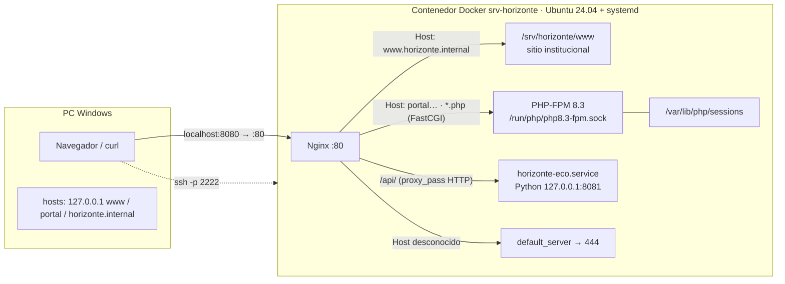

# Tecnología Web I (SIS-0150) — Actividad 01

**Universidad Privada Domingo Savio (UPDS)** · Ingeniería de Sistemas
**Docente:** M.Sc. Ing. Jimmy Nataniel Requena Llorentty
**Estudiante:** Leonardo Avila Bejarano · **Grupo:** CodeX

La Actividad 01 reúne los laboratorios 1 a 4. En ellos se construye, paso a paso, el servidor web `srv-horizonte` de la U.E. Horizonte (ficticia): desde entender una petición HTTP hasta publicar un portal PHP con sesiones seguras y una API detrás de un proxy inverso.

| Lab | Tema | Resultado | Detalle |
|---|---|---|---|
| 01 | El viaje de una petición HTTP: curl, DevTools y un servidor de práctica | 7 comandos curl + cookies + DevTools | [lab01/README.md](lab01/README.md) |
| 02 | Ubuntu Server 24.04 en Docker: usuarios, grupos, paquetes, red y servicios | Verificador 14/14 | [lab02/README.md](lab02/README.md) |
| 03 | Nginx con dos hosts virtuales, páginas de error propias y registros | Verificador 14/14 | [lab03/README.md](lab03/README.md) |
| 04 | Portal PHP-FPM y API por proxy inverso, con sesiones y cookies seguras | Verificador 16/16 | [lab04/README.md](lab04/README.md) |

## Arquitectura final



Puertos publicados por Docker: `8080→80` (HTTP), `2222→22` (SSH), `8443→443` (HTTPS).

## Estructura del repositorio

```
lab01/   pruebas HTTP con curl y DevTools
lab02/   Dockerfile, docker-compose.yml y preparar_servidor.sh
lab03/   configuración de Nginx (www, portal, rechazo de desconocidos, formato de log)
lab04/   horizonte-portal.conf, horizonte-eco.service, sesion.php, entrar.php
docs/    hojas de trabajo, bitácoras de IA, informe APA y presentación
```

## Cómo levantar el servidor

```powershell
cd lab02
docker compose up -d --build                     # la primera vez
docker compose exec -u leonardo servidor bash    # entrar como usuario sin privilegios
docker compose stop                              # apagar conservando todo (NO usar down)
docker compose start                             # volver a encender
```

Dentro del contenedor, los servicios se inician con `systemctl` (en Docker, `policy-rc.d` impide que arranquen solos al instalarlos):

```bash
sudo systemctl start nginx php8.3-fpm horizonte-eco
```

## Documentación

- Informe técnico (APA 7): `docs/Informe_Actividad01_Leonardo_Avila.docx`
- Hojas de trabajo y bitácoras de IA de cada laboratorio: carpeta `docs/`
- Presentación: exportada en `docs/` (PDF/PPTX)
