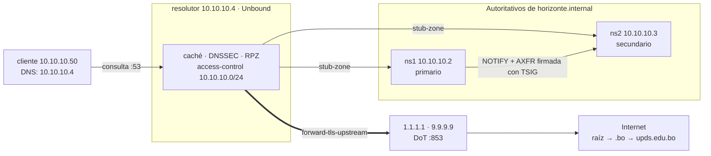

# Tecnología Web I (SIS-0150) — Actividad 02: Infraestructura DNS

**Universidad Privada Domingo Savio (UPDS)** · Ingeniería de Sistemas
**Docente:** M.Sc. Ing. Jimmy Nataniel Requena Llorentty
**Grupo:** CodeX — Leonardo Avila Bejarano, Rosa Salvatierra, Jesús Andrés Flores Paz, Juan Marcelo Soliz Miranda, Brayan Coronado Ribera, José Luis Céspedes Ramos

La Actividad 02 reúne los laboratorios 6 a 8. Se analiza el DNS de dominios reales, se monta el DNS **autoritativo** de la U.E. Horizonte (ficticia) con BIND9 —primario, secundario, zona inversa y transferencia con TSIG— y se agrega un **resolutor** Unbound con caché, DNSSEC, DNS sobre TLS y filtrado RPZ, más la zona pública gestionada como código con DNSControl.

| Lab | Tema | Resultado | Detalle |
|---|---|---|---|
| 06 | Radiografía DNS de dominios reales: jerarquía, registros, SOA, TTL | Verificador 12/12 | [lab06/README.md](lab06/README.md) |
| 07 | BIND9: zona directa e inversa, primario/secundario con TSIG y NOTIFY | Verificador 16/16 | [lab07/README.md](lab07/README.md) |
| 08 | Unbound: caché, DNSSEC, DoT, RPZ, stub-zones · DNSControl | Verificador 17/17 | [lab08/README.md](lab08/README.md) |

Los laboratorios 1 a 4 (Actividad 01) están en `lab01/` a `lab04/`.

## Topología



## Estructura del repositorio

```
lab06/          radiografia_dns.sh completado y análisis de dominios
lab07/          zonas y named.conf de ns1 y ns2
lab08/          Unbound, RPZ y DNSControl
red_dns/        Dockerfile y docker-compose.yml de la red tw1-dns
evidencias/     salidas de verificadores, tcpdump, preview y journal
informe/        informe técnico APA 7
presentacion/   presentación (PPTX / PDF)
```

## Cómo levantar la red DNS

```powershell
cd red_dns
docker compose -p tw1-dns up -d --build ns1 ns2 resolutor cliente   # la primera vez
docker compose -p tw1-dns exec ns1 bash                             # entrar a un nodo
docker compose -p tw1-dns stop                                      # apagar conservando todo (NO usar down -v)
docker compose -p tw1-dns start                                     # volver a encender
```

## Seguridad del repositorio

- La clave TSIG (`compartido/transferencia.key`) **no se publica**: está excluida en `.gitignore`.
- `creds.json` solo describe el proveedor local BIND de DNSControl; no contiene credenciales reales.
- Los dominios `.internal` y `.example` y las IP `203.0.113.0/24` son de uso privado o de documentación.
